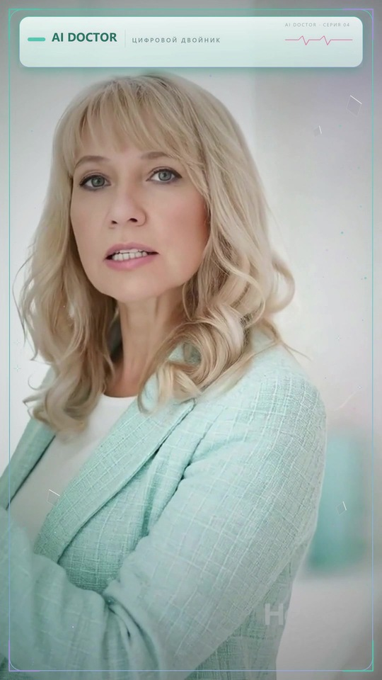
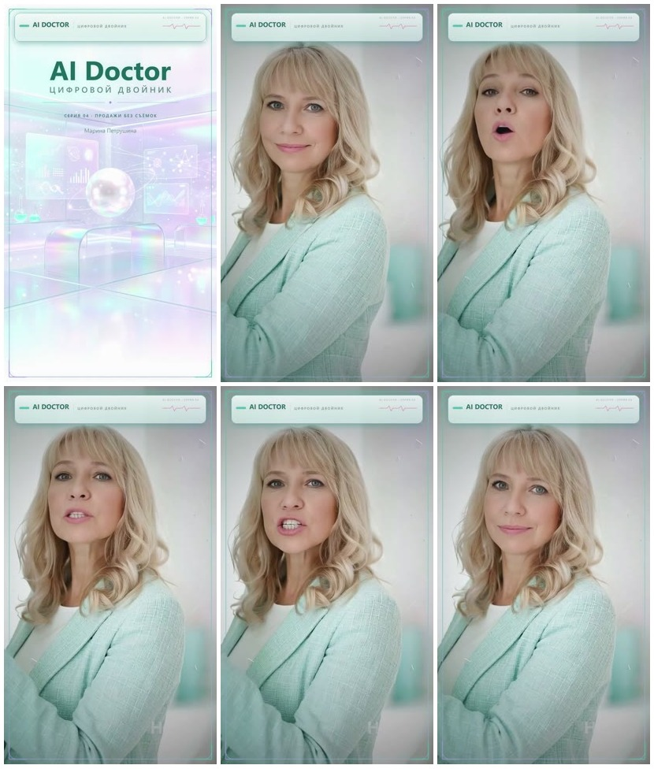

# Видео с ИИ-аватаром — AI Doctor

Реклама и контент, в которых говорит ваш цифровой двойник: без съёмочного дня, без актёров,
без студии. Один раз настраиваем аватар и клон голоса — дальше любой текст превращается
в готовый ролик за минуты.

**Что это даёт бизнесу:** регулярный контент перестаёт зависеть от свободного времени
владельца. Вы пишете текст — получаете видео со своим лицом и своим голосом.

---

## Услуги и цены

| Услуга | Что входит | Цена | Срок |
|---|---|---|---|
| **Тестовый ролик** 10–15 с | сценарий, аватар, голос, монтаж, 1080p | 2 000–5 000 ₽ (зачитывается в пакет) | 2–3 дня |
| **Ролик 20–60 с** | сценарий, генерация, монтаж, музыка, титры, 1080p + 720p | от 5 000 ₽ | 2–3 дня |
| **Пакет из 3 роликов** | единый стиль, заставка, шаблон серии | от 12 000 ₽ | 5–7 дней |
| **Серия 10 роликов** | контент-план, шаблон сцены, серийное производство | от 35 000 ₽ (≈ 3 500 ₽/ролик) | 10–14 дней |
| **Настройка аватара и голоса** | персональный клон в вашем аккаунте + инструкция | от 10 000 ₽ | 3–5 дней |
| **Подписка** | 4 ролика в месяц по готовому шаблону | 20 000 ₽/мес | поток |

Цена зависит от длительности, сложности сцены, количества правок и того, есть ли у вас
готовые исходники (фото/видео/аудио).

---

## Кейсы

### 1. Цифровой двойник по фото — 29,2 с

Задача: показать, что видео можно выпускать без съёмок. Собрали персональный аватар по фото,
клонировали голос, проверили липсинк на тестовом тексте. Результат — ролик 9:16, 1080p,
готовый к публикации. Время работы — около 2 часов после настройки аватара.

### 2. Конвейер «текст + окружение → видео» — 49,4 с

Задача: отдать клиенту не ролик, а процесс. Аватар и голос настроены в аккаунте заказчика,
сцена меняется по описанию, монтаж — по шаблону. Плюс заставка и лёгкая версия для мессенджеров.

### 3. Серия роликов под бренд — 41,9 с

Задача: серия 20–60 с в едином фирменном стиле. Сделали шаблон: заставка, оверлей,
цветокоррекция, музыка с нарастанием и затуханием. Каждый следующий ролик собирается
по этому шаблону — быстрее и дешевле. Результат: 1080p для публикации + 720p для мессенджеров.

Подробные карточки кейсов — [docs/02-кейсы.md](docs/02-кейсы.md).

## Как это выглядит

<p>
  
  
</p>

Слева — первый кадр ролика с заставкой и фирменным оверлеем, справа — раскадровка:
заставка, говорящий аватар, титры, финальный кадр.

---

## Как проходит работа

1. **Бриф (15–20 минут).** Задача ролика, площадка, длительность, формат кадра, тон, запреты.
2. **Сценарий.** Текст на 20–60 секунд речи, с разметкой пауз. Согласуем до генерации.
3. **Аватар и голос.** Клон по фото/видео и образцу голоса — или стилизованный персонаж,
   если в кадре не человек.
4. **Генерация и отбор.** 2–3 дубля, выбираем лучший по мимике и липсинку, правим паузы.
5. **Монтаж и упаковка.** Заставка, титры, музыка, цвет, экспорт 1080p + лёгкая 720p.
6. **Передача.** Файлы + исходники (чистый рендер без титров и музыки) + короткая инструкция.

---

## Что нужно от вас

- фото или видео человека, которого клонируем (фронтальный ракурс, ровный свет, без очков и жестов);
- 1–2 минуты чистой речи для клона голоса (без музыки и эха);
- текст или тезисы ролика;
- письменное согласие на клонирование лица и голоса (обязательно);
- доступ к сервису, если аватар должен жить в вашем аккаунте.

---

## Технические параметры

| Параметр | Значение |
|---|---|
| Кадр | 9:16 (Reels/Shorts/Клипы), 16:9 по запросу |
| Разрешение | 1080p основная версия, 720p лёгкая (CRF 27, faststart) |
| Частота | 25 fps |
| Кодек | H.264, CRF 18 |
| Звук | голос −3…−6 dB, музыка −18…−24 dB, лимитер на пике −3 dB |
| Длительность | 20–60 с (тест 10–15 с) |
| Исходники | чистый рендер без титров и музыки + версия с оформлением |

---

## Стек

| Задача | Инструмент |
|---|---|
| Клон аватара и липсинк | HeyGen (Instant/Custom Video Avatar) |
| Оживление фото + аудио, сложные сцены | Wan 3.0 / 3.0 Prime (API) |
| Клон голоса | HeyGen Voice Clone (альтернатива — ElevenLabs) |
| Синтез речи для персонажей | MiniMax Audio / ElevenLabs |
| Изображения и фоны | Flux, Gemini (nano-banana) |
| Монтаж, грейд, титры | CapCut, ffmpeg, Python/PIL |
| Музыка | Mixkit (бесплатная лицензия) |

---

## Честные ограничения

- **Аватар — не живой человек.** На крупном плане заметны микродвижения; лечится ракурсом,
  светом и длиной фраз, но не исчезает полностью.
- **Клон требует исходников и согласия.** Без 1–2 минут чистой речи и фото должного качества
  результат будет хуже, и мы скажем об этом до оплаты.
- **Квоты и водяные знаки.** На бесплатных тарифах HeyGen остаётся водяной знак и 720p;
  1080p и снятие знака — платно. Это закладывается в смету заранее.
- **Не всё можно сгенерировать.** Сервисы блокируют реальных людей (например, Seedance),
  ограничивают длину сцены (Wan 2.6/2.7 — 5–10 с) и по-разному ведут себя на русском.
- **Ударения и имена.** Названия брендов, топонимы и сложные слова проверяются вручную.

---

## Частые возражения

**«ИИ-аватар выглядит неестественно».** Поэтому мы не берём первый дубль: 2–3 генерации,
отбор по мимике, правка пауз. Плюс стилизация там, где фотореализм только мешает.

**«Дорого, я сам сниму на телефон».** Съёмка — это свет, фон, дубли, монтаж и час времени
на каждый ролик. Здесь час нужен один раз, дальше — только текст.

**«А если я поменяю причёску/бороду?».** Аватар обновляется по новым фото; для серии это
10–15 минут работы.

**«Кому принадлежат файлы?»** Вам: готовые ролики, исходники и настройки в вашем аккаунте.

---

## Структура репозитория

```
README.md                        — услуги, кейсы, процесс, цены
docs/01-услуги-и-цены.md         — детальный прайс и условия
docs/02-кейсы.md                 — карточки кейсов + разбор 5 реальных заказов
docs/03-процесс.md               — производственный регламент и чек-лист приёмки
docs/04-сравнение-сервисов.md    — HeyGen vs Wan 3.0 Prime: липсинк, лимиты, цены
docs/05-отклик-и-возражения.md   — шаблон отклика, аргументы, работа с возражениями
```

---

## Контакты

**AI Doctor** · Марина Петрушина
Почта: mar.petrushina@yandex.ru
Формат работы: разовый ролик, пакет, подписка. Оплата поэтапно, тест зачитывается в пакет.

> Репозиторий носит презентационный характер: здесь описаны услуги, процесс и кейсы.
> Все цены — ориентиры; финальная смета считается по брифу.
